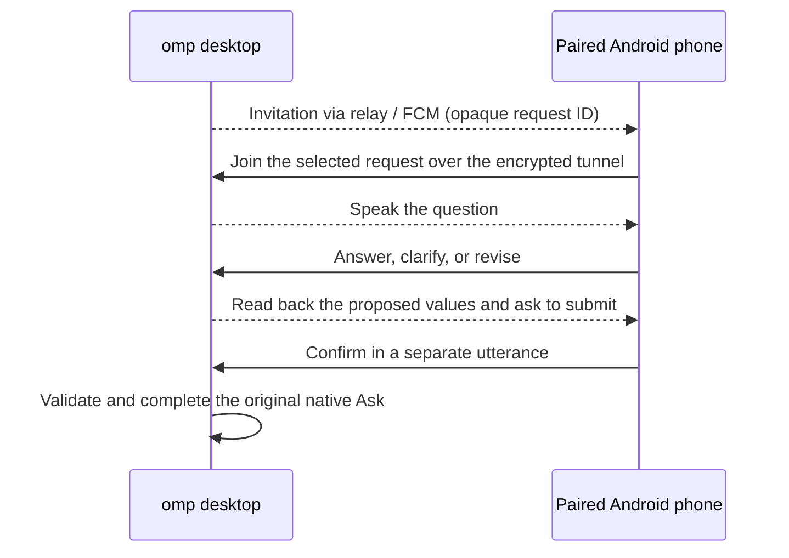

<p align="center">
  
</p>

<p align="center"><strong>Step away. Stay in the loop.</strong></p>

<p align="center">
  Answer your coding agent’s questions from your Android phone.<br>
  Your desktop keeps the session, the tools, and the final say.
</p>

<p align="center">
  <a href="#how-it-works">How it works</a> ·
  <a href="#get-started">Get started</a> ·
  <a href="#security-and-privacy">Security</a> ·
  <a href="#development">Development</a>
</p>

---

**Away** connects [oh-my-pi](https://github.com/can1357/oh-my-pi) to a paired Android phone. When a supported native **Ask** form needs your input, you can receive an invitation, discuss the question by voice, hear your proposed answer, and confirm it—without returning to the keyboard.

> **Developer preview.** This is a source-based, self-hosted setup, not a one-click mobile service. It requires a running desktop session, a configured relay, and a paired Android app. The current integration is pinned to **omp 19.1.0**.

## Why Away?

- **Keep moving.** Get a phone invitation when the agent needs a decision, or enable a delayed fallback while you work at your desk.
- **Ask before answering.** Clarifications go back to the coding session that owns the question, rather than a separate context-free assistant.
- **Change your mind.** Revise a proposal before confirming it. A proposal or a spoken claim of success is never a submission.
- **Keep sessions separate.** A shared desktop gateway combines their requests into one phone inbox while preserving each session’s context and authority.
- **Stay in control.** The desktop form remains available. Answering there finishes the request; hanging up leaves an unanswered request pending.

## How it works



The phone is a companion, not a second coding-agent runtime. Live voice uses the desktop’s Codex connection; native validation and submission stay on the desktop.

## Get started

### 1. Prepare the components

| Component | What you need | Guide |
|---|---|---|
| Desktop plugin | omp 19.1.0, desktop Codex login, Bun 1.4.4+, `uv`, Python helper environments | [Desktop setup](plugin/DEBUG.md#connect-an-actual-phone) |
| Android app | JDK 17, Android SDK 36, Gradle 8.14.3, Firebase Android client configuration; Google Play services for invitations | [Build and pair](android/DEBUG.md) |
| Relay | Go 1.26+, a CA-trusted HTTPS endpoint, and a dedicated Firebase Cloud Messaging identity | [Deploy the relay](relay/DEBUG.md) |

```sh
git clone https://git.example.invalid/neko/omp-away.git
cd omp-away/plugin
bun install
uv sync --locked --project tunnel --python 3.12
uv sync --locked --project media --python 3.12
```

Build and provision the relay and Android app using their guides. Credentials and Firebase configuration are deliberately **not** included in this repository.

### 2. Configure the desktop

Set these in the environment of the desktop process:

| Variable | Value |
|---|---|
| `OMP_AWAY_URL` | Your relay’s HTTPS origin |
| `OMP_AWAY_TOKEN_FILE` | Absolute path to the private desktop bearer-token file |
| `OMP_AWAY_STATE_DIR` | Absolute path to a dedicated, private local state directory |
| `OMP_AWAY_TUNNEL_PYTHON` | Absolute path to the Python interpreter in `plugin/tunnel/.venv` |

Use the same origin, token, and state directory for sessions sharing one paired desktop. Pass credential **paths**, never token contents, on the command line. Keep the state directory outside source control and cloud-synced folders.

Create a per-run configuration overlay, for example `away.yaml`:

```yaml
collab:
  relayUrl: ws://127.0.0.1:18475
  autoStart: control
ask:
  timeout: 0
```

Launch from your project, replacing the paths with absolute paths on your machine:

```sh
omp --config /absolute/path/away.yaml -e /absolute/path/omp-away/plugin
```

Wait for **Away: local guest ready** and **Away: secure mobile gateway ready**. Keep the Collab endpoint on loopback; do not expose it publicly.

### 3. Pair, then enable invitations

1. From an idle desktop composer, run `/away pair`.
2. Use the phone’s **Pair from clipboard** flow, or a trusted offline QR renderer. Never paste the pairing payload into a chat or an online QR service.
3. Compare **all twelve emoji**, in order, on both devices. Approve on the phone and use the desktop widget’s `/away approve CODE` only when they match.
4. Enable invitations and notification permission in the app. Grant microphone access when you want to answer by voice.
5. Run `/away on` on the desktop. Pair before creating a request: newly paired devices do not inherit already-open questions.

### Everyday commands

| Command | Purpose |
|---|---|
| `/away on` | Enable immediate invitations |
| `/away off` | Disable immediate invitations; leave a configured fallback unchanged |
| `/away fallback 90` | Escalate an unanswered request after 90 seconds |
| `/away fallback off` | Disable delayed escalation |
| `/away status` | Inspect the current routing settings |
| `/away pair` | Start a new, explicitly approved pairing from an idle desktop |

For routing scope, multi-session behavior, and upgrade notes, see [routing and call behavior](plugin/DEBUG.md#routing-and-call-behavior).

## Security and privacy

- **The relay forwards ciphertext.** An inner, pinned TLS connection terminates on the desktop and phone, independently of the relay’s public HTTPS connection.
- **Push notifications carry only an opaque request ID.** Questions, answers, audio, and coding context are not placed in FCM payloads.
- **Desktop credentials stay off the phone.** Voice and model requests use the desktop’s existing authentication. The voice provider processes speech; the system is not offline or local-only.
- **Confirmation is explicit.** Native field validation, request ownership, stale-answer rejection, and exactly-once submission remain desktop responsibilities. A notification, caption, or assistant utterance cannot authorize a submission.
- **Transcripts are sensitive.** The desktop can retain local call transcripts. Review the [transcript retention controls](plugin/DEBUG.md#retained-call-transcripts) before sharing logs. Never commit credentials, pairing payloads, or private state.

If the phone or voice connection fails, complete the original form on the desktop. Away does not silently approve an unanswered question.

## Development

| Directory | Responsibility |
|---|---|
| [`plugin/`](plugin/) | omp extension, native Ask bridge, voice decisions, local gateway broker, and media helpers |
| [`android/`](android/) | Pairing, request inbox, invitations, voice playback/capture, and captions |
| [`relay/`](relay/) | HTTPS endpoints, FCM delivery, and opaque tunnel forwarding |
| [`docs/`](docs/) | Cross-component protocol, design notes, and verification evidence |
| [`tools/acceptance/`](tools/acceptance/) | Integration acceptance tooling |

Run checks from the corresponding directory:

| Directory | Checks |
|---|---|
| `plugin/` | `bun test test` · `bun check` |
| `plugin/tunnel/` | `uv run --locked python -m unittest discover -s tests` |
| `plugin/media/` | `uv run --locked pytest tests` |
| `relay/` | `go test -race ./...` |
| `android/` | Follow the [pinned Gradle build and test procedure](android/DEBUG.md#build) |

**Preserve paired-device data.** Use a targeted `adb -s <serial> install -r` when updating an approved test device. Do not use `connectedDebugAndroidTest` on a paired device: its cleanup can uninstall the app and remove pairing.

### Further reading

- [Desktop integration and troubleshooting](plugin/DEBUG.md)
- [Android build, pairing, and audio diagnostics](android/DEBUG.md)
- [Relay installation and security boundaries](relay/DEBUG.md)
- [Cross-component protocol](docs/PROTOCOL.md)
- [End-to-end verification notes](docs/verification/away-e2e.md)

---

Built for [oh-my-pi](https://github.com/can1357/oh-my-pi). Away’s visual identity takes inspiration from its [hero artwork](https://github.com/can1357/oh-my-pi/blob/main/assets/hero.png), with an original generated monogram and independently composed banner.
